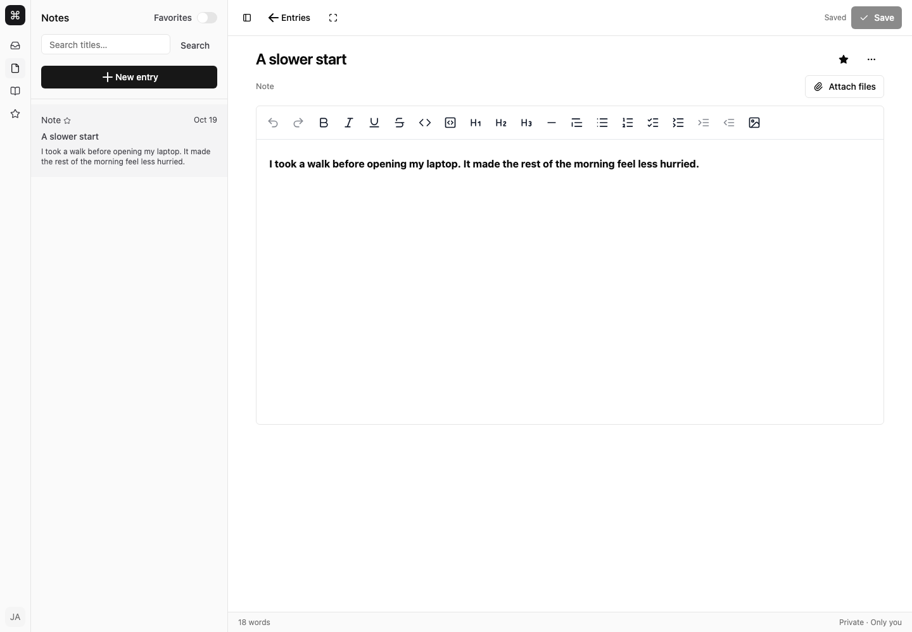

# Notebook

A private notes and journaling app built with React, TanStack Router, PocketBase,
shadcn/ui and ProseKit. Write a thought, save it, and return to it later.



The interface at `/entries` uses shadcn’s `sidebar-09` and ProseKit’s full
editor block. See [component sources and adaptations](docs/design/prebuilt-ui.md).

## What works

- Rich-text notes and journals with lists, tables, links, code, math and image uploads.
- Private image/PDF/text attachments stored through PocketBase and MinIO, with protected downloads.
- Title search, favorites, journal date filters and paginated lists. Filters stay in the URL.
- Explicit Save, unsaved-change prompts and conflict detection when two tabs edit the same entry.
- Private PocketBase records with server-side document validation and ownership rules.
- Collapsible navigation and full-screen writing for new and saved entries.
- Mobile list/editor navigation, keyboard formatting and Ctrl/Cmd+S.
- Existing login, registration, verification and password-reset screens.

[Mobile screenshot](docs/images/notebook-mobile.png) ·
[Design and scope](docs/design/notes-journal.md) ·
[Verification](docs/VERIFICATION.md)

## Run locally

```sh
cp .env.example .env
openssl rand -base64 24  # set PB_ENCRYPTION_KEY in .env
make start
```

Set the superuser credentials and matching `PB_PORT` / `VITE_PB_URL` in `.env`.
`make start` starts PocketBase, seeds the development account, and runs Vite.
The default development login is `user@example.com` / `user-changeme-123`;
`SEED_USER_EMAIL` and `SEED_USER_PASSWORD` override it. Sample entries are added
only when that account's notebook is empty.

For email and S3-backed file storage, use `make start-full` instead. It configures
Mailpit and MinIO automatically; `make check-services` verifies both. See the
[full-stack setup](docs/DEVELOPMENT.md#full-stack-mailpit-smtp--minio-s3).

## Checks

```sh
bun run lint
bun run build
bun run scripts/test-entries.ts
```

The API test requires the running backend and superuser credentials in `.env`.
It creates temporary accounts, tests access boundaries and concurrent saves,
and deletes those accounts afterward. Use a development instance.

Browser checks require an available Playwright installation and Chromium:

```sh
node --env-file=.env scripts/test-browser.cjs
```

For a global Playwright installation, set `NODE_PATH` to its module directory.
`TEST_APP_URL` defaults to the local Vite server. Browser checks create their own
account, exercise real UI/API behavior, capture screenshots and clean up the account.

## Boundaries

Entries are private through application access rules, not end-to-end encryption.
Drafts are in memory until Save; browser crashes can lose unsaved work. Conflict
recovery offers a plain-text copy and a confirmed reload, not automatic merging.
There is no sharing, AI or offline synchronization. See [attachments](docs/ATTACHMENTS.md)
for file limits, private storage and cleanup behavior.
OAuth providers and production email still require PocketBase configuration.
Local email delivery is captured by Mailpit in full-stack mode.

See [development setup](docs/DEVELOPMENT.md), [deployment](deploy/README.md),
and [root configuration](docs/ROOT-FILES.md).
