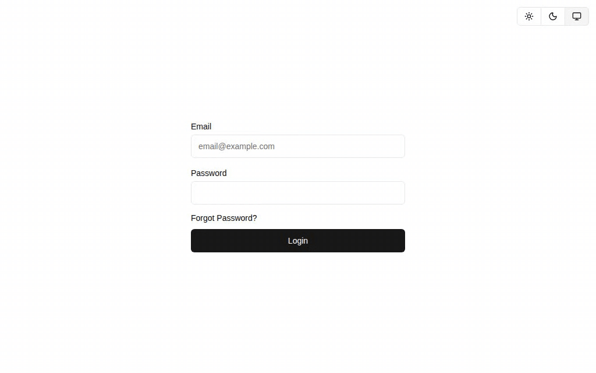
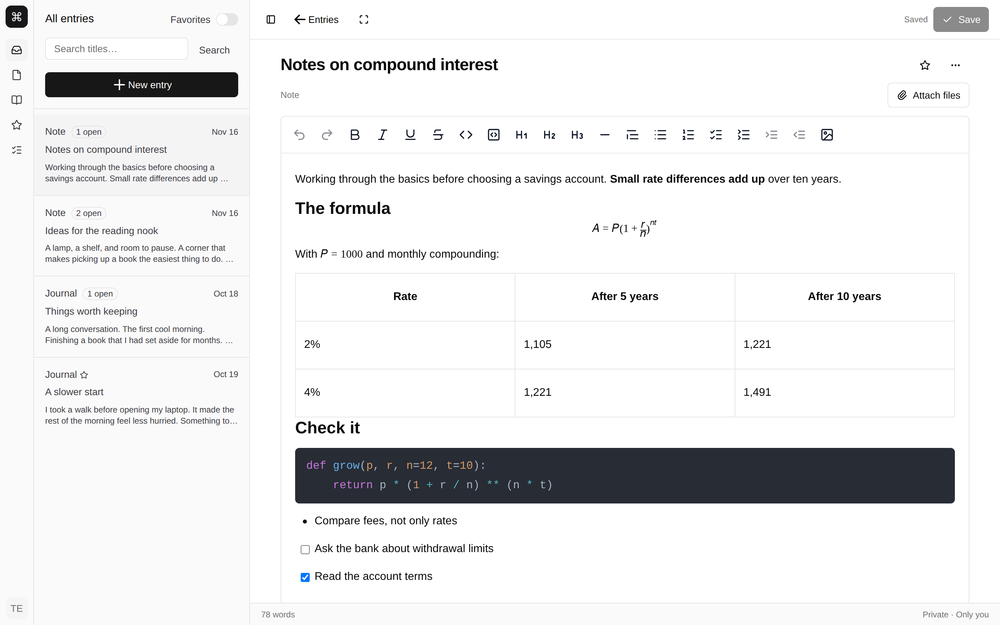
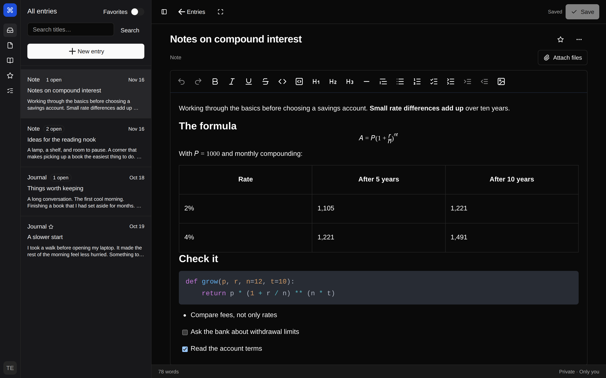
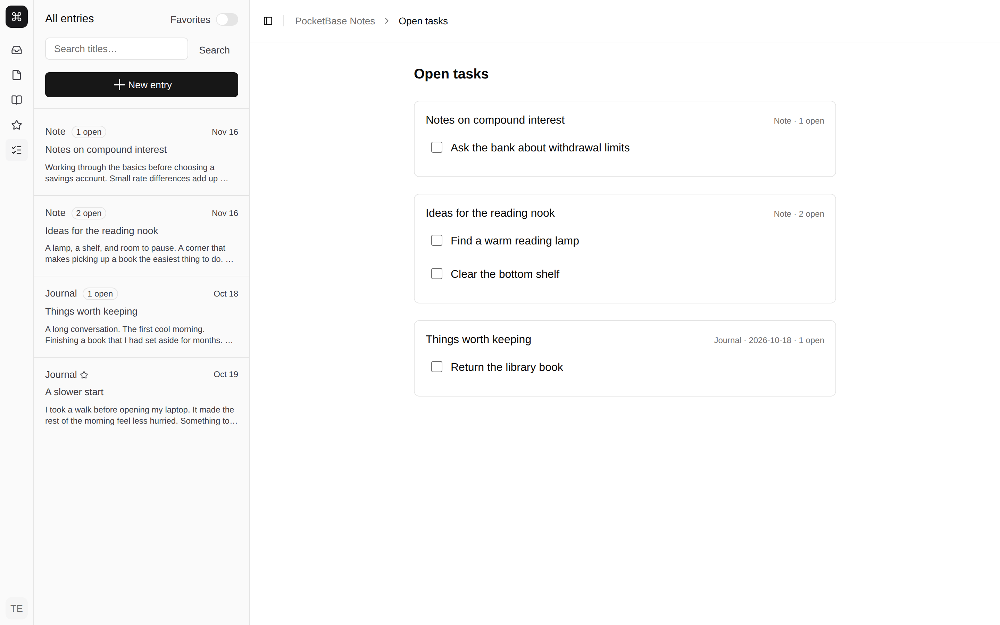
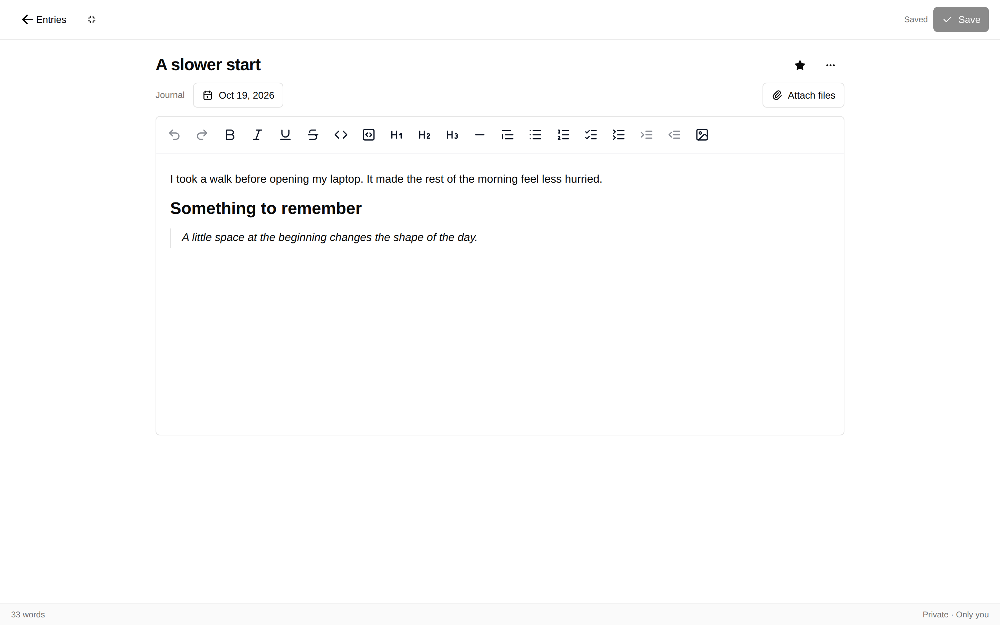
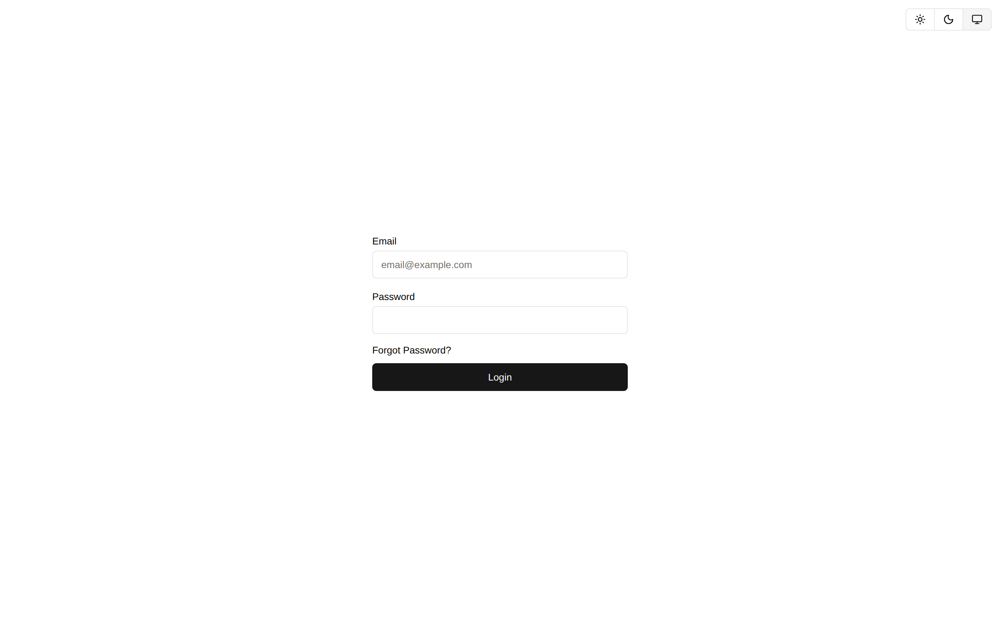
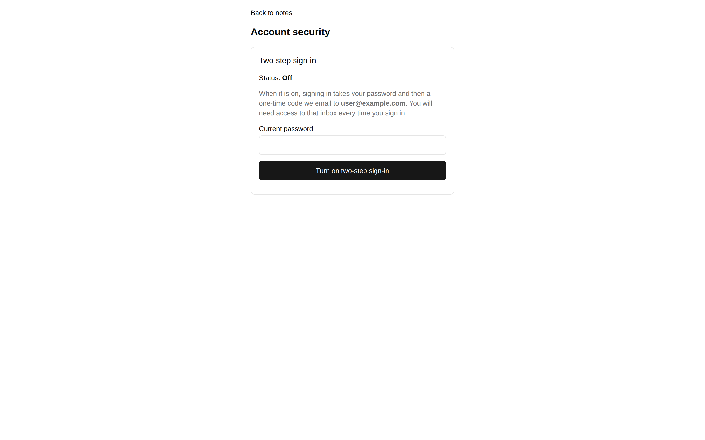
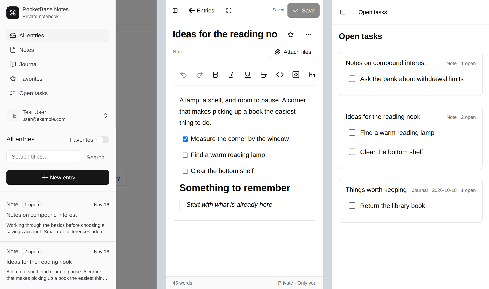

# PocketBase Notes

A private notes and journal app you run yourself. One Docker image holds the
whole thing: the React frontend, the PocketBase API and database, and the
server hooks. Your entries live on your server, readable only by your account.



## Why this exists

Most note apps either keep your writing on someone else's servers or ask you to
assemble a backend, auth, file storage and an editor yourself. This is a small,
complete app instead: a good rich-text editor, journal entries with dates, and
a task view, on a backend that is a single binary with a SQLite file. Run it on
your laptop with one command, or host your own instance on Railway.

There is deliberately no public demo: run it locally (below) to try it.

## What you get

- **Notes and dated journal entries** in one ProseKit editor: headings, lists,
  checklists, tables, links, code blocks with highlighting, and KaTeX math.
- **Open tasks**: every unchecked checklist item across your entries in one
  list. Tick one off there and it is saved into its entry, with the same
  conflict check as the editor. Each entry shows its open count
  ([how it works](docs/features/tasks.md)).
- **Find things**: title search, favorites, note/journal filters and journal
  date filters; filters stay in the URL.
- **Saving you can trust**: explicit Save (or Ctrl/Cmd+S), a prompt before
  leaving unsaved changes, and conflict detection when two tabs edit one entry.
- **Attachments**: private images, PDFs and text files with protected downloads.
- **Light, dark or system theme**, from the login page or the user menu.
- **Opt-in two-step sign-in**: after the password, a one-time code sent by
  email. Turned on per account from Account security
  ([sign-in](docs/features/auth.md)).
- **Phone-friendly** list and editor, and a full-screen writing mode.

| Notebook, light | Notebook, dark |
| --- | --- |
|  |  |
| **Open tasks** | **Full-screen writing** |
|  |  |
| **Sign in, with the theme control** | **Account security** |
|  |  |



All screenshots and the recording are captured from a running local stack with
the sample data by [`scripts/capture-screenshots.sh`](scripts/capture-screenshots.sh).

## Try it

You need [Docker](https://docs.docker.com/get-docker/) with Compose.

```sh
git clone https://github.com/hsb3/pocketbase-notes-app.git && cd pocketbase-notes-app
make app
```

`make app` creates `.env` with generated secrets, builds the image, starts the
app with local email (Mailpit) and file storage (RustFS), adds sample entries,
and prints the address and login (`http://127.0.0.1:8100`,
`user@example.com` / `user-changeme-123`). `make stack-down` stops it and keeps
the data. More in [local stacks](deploy/LOCAL.md).

## Develop

```sh
bun install
make start   # PocketBase in Docker, sample account, Vite with hot reload
```

`make start-full` adds Mailpit and RustFS for email and attachments. Setup,
seed accounts and every Makefile target: [development setup](docs/development/setup.md).
How the pieces fit: [tech stack](docs/architecture/tech-stack.md).

## Test

```sh
bun run lint && bun run knip && bun run build   # static checks
bun run test:install                            # Playwright browsers, once
make up-full && make e2e                        # API and browser tests, desktop and mobile
```

Tests create and delete their own accounts on the local backend. CI runs the
same suite on Linux amd64 and arm64 for every pull request. Details:
[verification](docs/testing/verification.md),
[load testing](docs/testing/load-testing.md) (`make load-test`) and
[CI and repository rules](docs/ci/checks-and-rules.md).

## Deploy

Every target runs the same [image](deploy/IMAGE.md). To host your own private
instance, follow [self-host on Railway](deploy/RAILWAY.md): one service, one
volume, real outgoing email and scheduled backups, with public signup off.
Other options: [deployment overview](deploy/README.md).

## Boundaries

- Entries are private through PocketBase access rules, not end-to-end
  encryption: whoever runs the server can read the database.
- Drafts live in memory until you save; a browser crash can lose unsaved work.
- Conflicts are detected, not merged: you get a plain-text copy of your draft
  and a confirmed reload.
- No sharing, AI features or offline sync.
- Two-step sign-in and password resets need working email. Locally Mailpit
  catches it; a real deployment needs an SMTP provider. OAuth providers need
  PocketBase configuration ([sign-in](docs/features/auth.md)).
- File limits, storage and cleanup: [attachments](docs/features/attachments.md).

## More

- Documentation site: <https://hsb3.github.io/pocketbase-notes-app/>
- [Contributing](CONTRIBUTING.md) · [Security policy](SECURITY.md) ·
  [Changelog](CHANGELOG.md) · [License (MIT)](LICENSE)

[](https://github.com/hsb3/pocketbase-notes-app/actions/workflows/ci.yml)
[](LICENSE)
[](https://hsb3.github.io/pocketbase-notes-app/)
