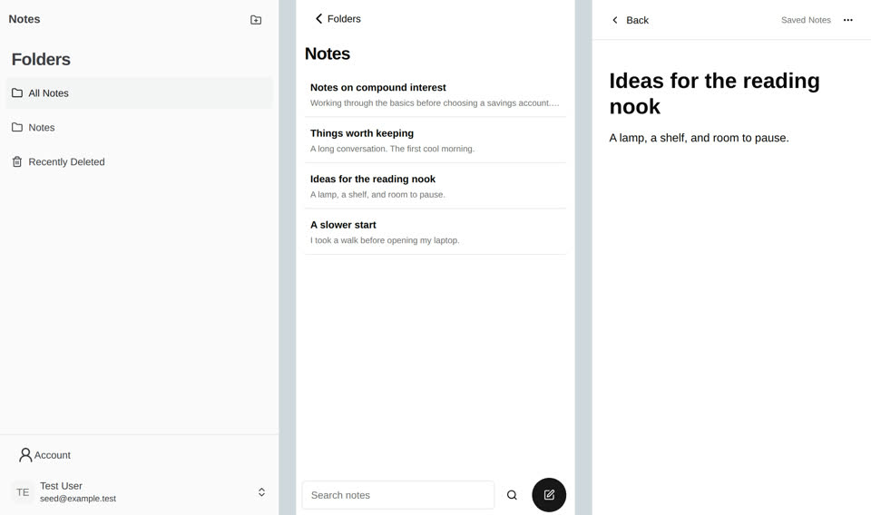
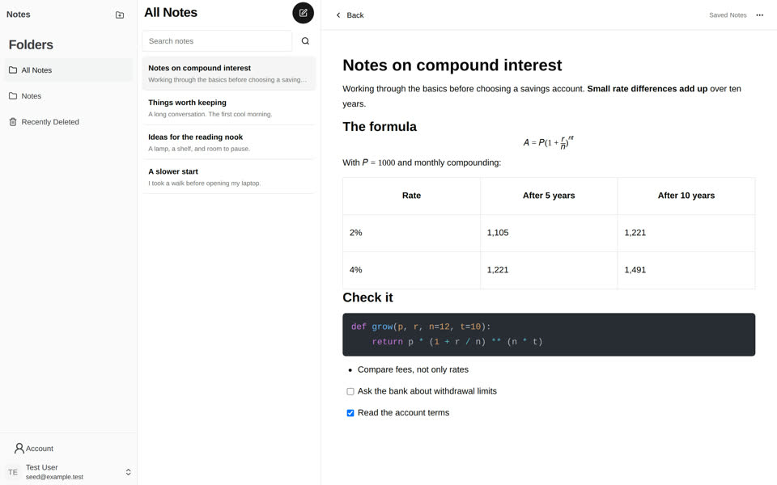

# PocketBase Notes

PocketBase Notes is a private, self-hosted notebook. On a phone, open a folder, tap **Compose** and start writing. The first line becomes the title. When **Saved** appears, the server has the latest edits. On a desktop, sign in to the same account and search for a phrase from the note, even if it only appears in the body. Search spans folders. Open the result to read the note, then use **Back** to return to the same results.



On a desktop, the folders, note list and editor sit side by side. From **Note actions**, move a saved note to another folder or delete it. To undo a deletion, open **Recently Deleted** and select **Restore** before the deadline shown beside the note.



## Milestone 1

The current milestone checks the capture-and-find workflow across screen sizes, account privacy and recovery from save failures. The roadmap will be revisited after Milestone 1. [Milestone 1 gate](specs/002-notes-redesign/r6-gate/spec.md)

## Try it locally

This quick start requires Git, Make and Docker with Compose.

```sh
git clone https://github.com/hsb3/pocketbase-notes-app.git
cd pocketbase-notes-app
make app
```

`make app` starts the notebook with sample notes and prints the local address and login. To stop it and keep the data, run `make stack-down`. [Local stacks](deploy/LOCAL.md)

## Data and recovery

- Notes are private to the signed-in account. The server operator can read the database.
- Unsaved edits live in the open tab. If another session saves a conflicting edit, use **Copy draft** to keep the local text before choosing **Reload saved**. [Notebook and save behavior](docs/features/notes.md)
- **Back up an entries-based installation before upgrading and keep the matching app revision.** The R2 migration deletes the legacy entries collection and its data. [Rollback and restore](deploy/OPERATIONS.md#rollback)

## Project guides

- [Development setup](docs/development/setup.md) and [verification](docs/testing/verification.md)
- [Sign-in and account recovery](docs/features/auth.md)
- [Deployment options](deploy/README.md) and [backups](deploy/OPERATIONS.md#backups)
