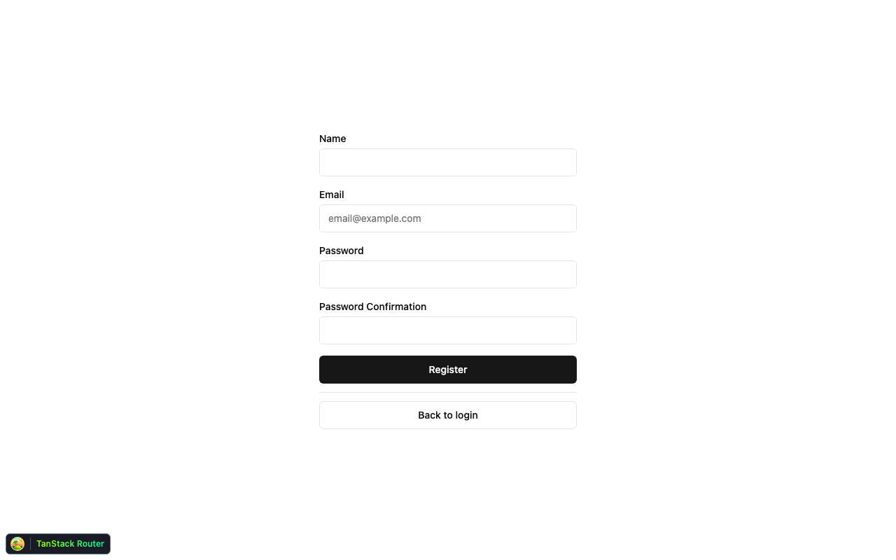
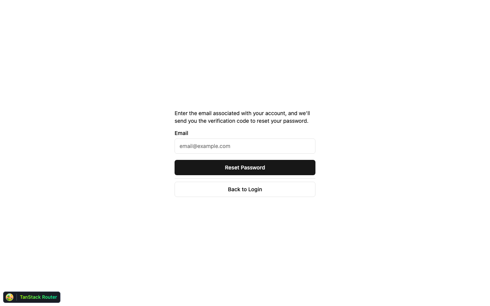
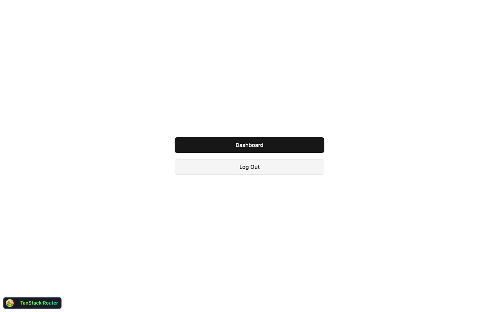

# React + PocketBase

A React SPA starter wired to PocketBase, with the auth screens, session-aware
routing, and Docker/Railway deploy already built — so a new project starts
from a working app instead of a blank one.

## Why this exists

Every React + PocketBase project re-derives the same boilerplate: login and
register forms, password reset and email verification flows, a route guard
that redirects unauthenticated users, typed access to PocketBase collections,
and a Docker image that ships both the frontend and the backend. This project
does that once so you don't.

## What you get today

- **Custom auth pages** on top of PocketBase's API (not its default admin-style
  UI): login (password + GitHub OAuth2), register, password reset
  request/confirm, email verification request/confirm. Proof below.
- **Session-aware routing** via TanStack Router — the root route resolves
  `isAuthenticated` from PocketBase's local auth store before first render;
  an `_authenticated` layout route redirects anyone unauthenticated to
  `/auth/login`.
- **Typed PocketBase client** — `make codegen` runs `pocketbase-typegen`
  against your running instance, so collection records are typed without
  hand-maintained interfaces.
- **One Docker image** serving both the built frontend and PocketBase, with a
  pinned, checksum-verified PocketBase binary per architecture (native
  arm64/amd64 builds), plus a Railway config-as-code file.
- **A local dev stack** with optional Mailpit (SMTP capture) and MinIO (S3)
  so email and file-upload flows are testable without real credentials.

**What it is not (yet)**

- No real application past auth — `/dashboard` is a literal placeholder
  (`<div>Dashboard</div>`), not a built screen.
- No automated tests. Verified so far by hand: login, register, logout, and
  routing guards against a live seeded PocketBase instance (see proof below).
- The GitHub OAuth2 button is wired to PocketBase's OAuth2 flow but needs a
  GitHub OAuth app and a matching PocketBase provider config to complete a
  real login.
- One `users` collection, no role/permission model beyond PocketBase's
  defaults.

## Proof

Captured from the actual running app — Vite dev server in front of a real,
freshly seeded PocketBase 0.40 instance, zero browser console errors.

| Logged out | Login |
|---|---|
|  |  |

| Register | Password reset request |
|---|---|
|  |  |

Logging in as the seeded test user (`user@example.com`) against the live
PocketBase backend actually flips the app's auth state — this isn't mocked:



## Roadmap

- Build a real screen behind `/dashboard`.
- Add automated coverage (unit + Playwright e2e) for the auth flows.
- Document a working GitHub OAuth2 app setup end to end.

## Getting started

```sh
cp .env.example .env
openssl rand -base64 24   # paste into PB_ENCRYPTION_KEY in .env
make start                # PocketBase + seed data + vite dev server
```

See [`docs/DEVELOPMENT.md`](docs/DEVELOPMENT.md) for the full local dev setup
(Mailpit/MinIO, all Makefile targets) and [`deploy/README.md`](deploy/README.md)
for Docker/Railway deployment.
