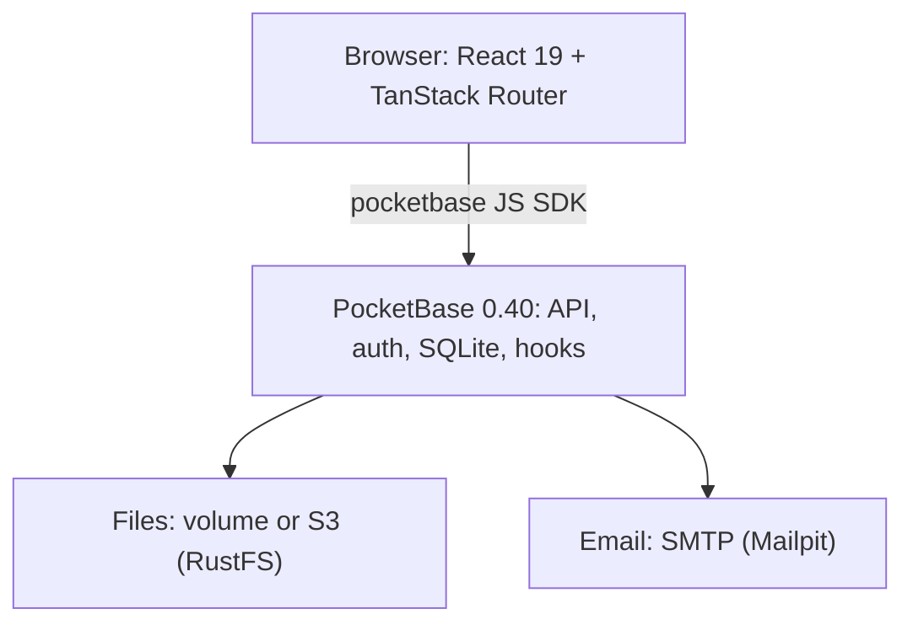

# Tech stack

What each piece is and why it is here. Versions are the ranges in
[`package.json`](../../package.json) and the pins in
[the Dockerfile](../../deploy/docker/Dockerfile).

## How the pieces fit

One Docker image holds both halves: Vite builds the frontend, and PocketBase serves
the result from `pb_public` next to its API. Locally, Docker Compose adds Mailpit
and RustFS; on Railway the same image runs with a volume and a real SMTP provider.

## Frontend

| Piece | What it is | Why it is here |
| --- | --- | --- |
| React 19 | UI library (`react`, `react-dom` ^19.2) | The app is a single-page React app; components come from React ecosystems (shadcn/ui, ProseKit). |
| TanStack Router | Type-safe, file-based router (`@tanstack/react-router`) | Routes live in `src/routes/`; the Vite plugin generates `src/route-tree.gen.ts`. Search filters stay in the URL. |
| ProseKit | Rich-text editor toolkit on ProseMirror (`prosekit` ^0.22) | The note editor is ProseKit's full editor example, adapted in `src/components/editor/`. See [adopted prebuilt UI](../design/prebuilt-ui.md). |
| shadcn/ui + Tailwind CSS 4 | Copy-in Radix-based components styled with Tailwind (`@tailwindcss/vite`) | The workspace is shadcn's `sidebar-09` block; components live in `src/components/ui/` and follow [`components.json`](../../components.json). |
| `pocketbase` JS SDK | Typed client for the PocketBase API (^0.28) | Auth, records and files. Types come from `pocketbase-typegen` (`make codegen`). |

## Backend

| Piece | What it is | Why it is here |
| --- | --- | --- |
| PocketBase 0.40 | Single Go binary: REST API, auth, SQLite, file storage, JS hooks | The whole backend. Collections and API rules are defined in [migrations](../../pb/migrations); document validation and attachment cleanup run in [hooks](../../pb/hooks). |
| Server/SDK coupling | Server 0.40.x pairs with the JS SDK ^0.28 | Bump both together, then regenerate types. The server version and per-arch SHA256 are pinned in the Dockerfile. |

## Tooling

| Piece | What it is | Why it is here |
| --- | --- | --- |
| Bun | Runtime, package manager and script runner | `bun install`, `bun run`, and the setup/test scripts in `scripts/`. [`bunfig.toml`](../../bunfig.toml) enforces a 7-day release-age cooldown. |
| Vite | Dev server and bundler | `bun dev` and `bun run build` (after `tsc`). |
| Biome | Formatter and linter | `bun run lint`; owns unused-variable checks. |
| knip | Unused files, exports and dependencies | `bun run knip`, run in CI. |
| Playwright | Browser tests in Chromium and WebKit | `bun run test:e2e`; see [verification](../testing/verification.md). |
| VitePress | This docs site | `bun run docs:build`; pages are the repository's own Markdown. |

## Services and hosting

| Piece | What it is | Why it is here |
| --- | --- | --- |
| Docker | Multi-arch image and Compose stacks | [`deploy/docker/Dockerfile`](../../deploy/docker/Dockerfile) builds the frontend and packages PocketBase; [local stacks](../../deploy/LOCAL.md) run it with limits. |
| RustFS | S3-compatible object storage | Local full stack: PocketBase stores attachments in a RustFS bucket, so the S3 path is tested. |
| Mailpit | Local SMTP server with a web inbox | Local full stack: catches verification and password-reset email. |
| Railway | Container hosting | Production target: builds the Dockerfile, one volume for data, scheduled backups to a bucket. See [self-host on Railway](../../deploy/RAILWAY.md). |
