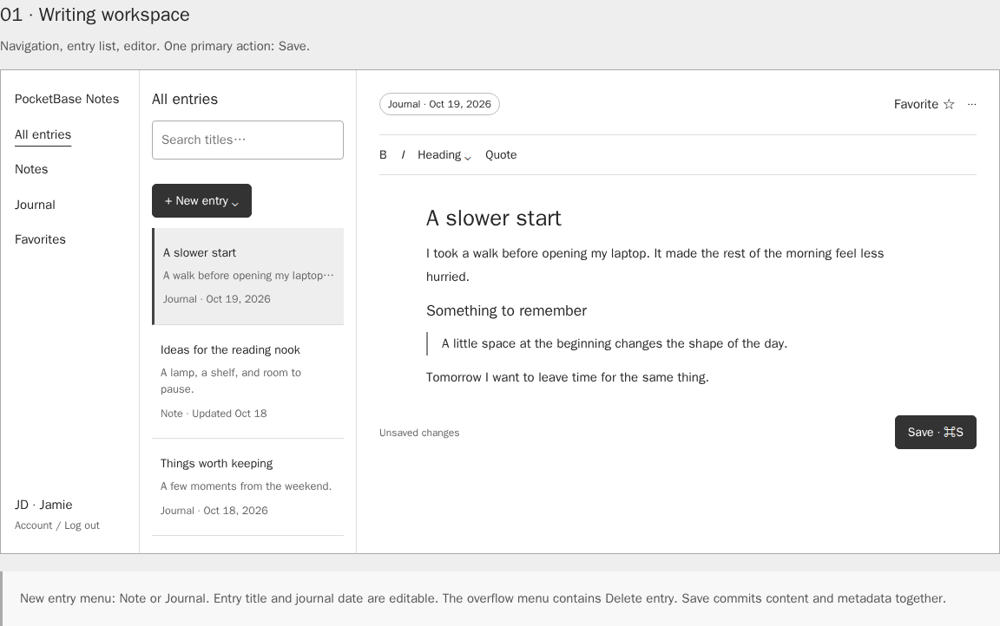
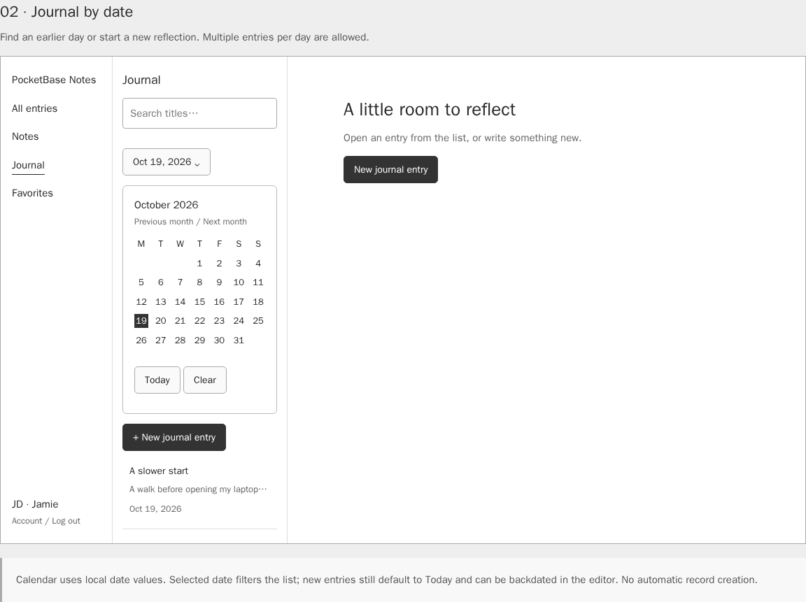
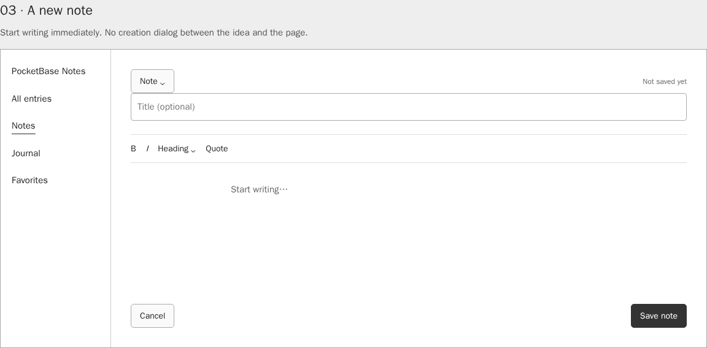
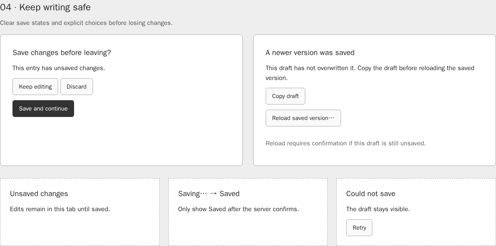
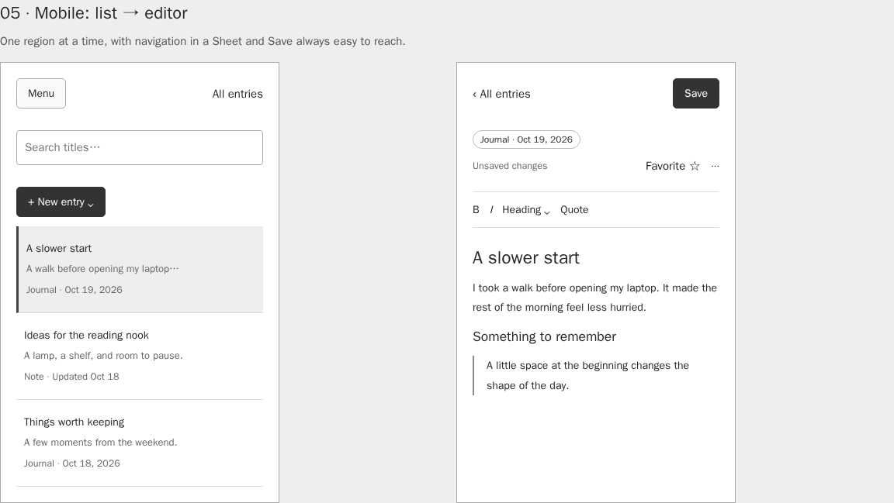
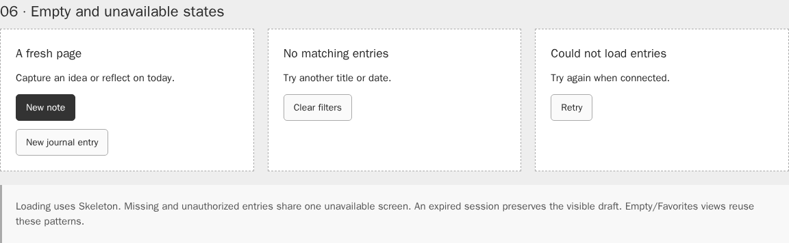

# Notes and journal wireframes

Early, static layout sketches for the [notes and journal design](notes-journal.md).
They are historical: the adopted implementation is described in
[adopted prebuilt UI](prebuilt-ui.md). The images below are rendered from
[the original HTML wireframes](notes-journal-wireframes.html), which the docs site
serves as a standalone page.

## 01 · Writing workspace

Navigation, entry list, editor. One primary action: Save.

## 02 · Journal by date

Find an earlier day or start a new reflection. Multiple entries per day are allowed.

## 03 · A new note

Start writing immediately. No creation dialog between the idea and the page.

## 04 · Keep writing safe

Clear save states and explicit choices before losing changes.

## 05 · Mobile: list → editor

One region at a time, with navigation in a Sheet and Save always easy to reach.

## 06 · Empty and unavailable states

